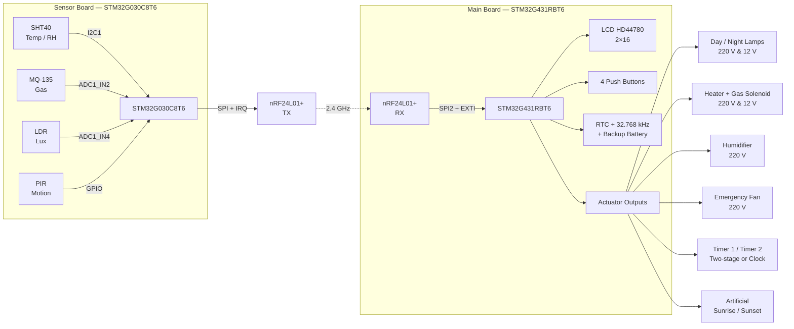
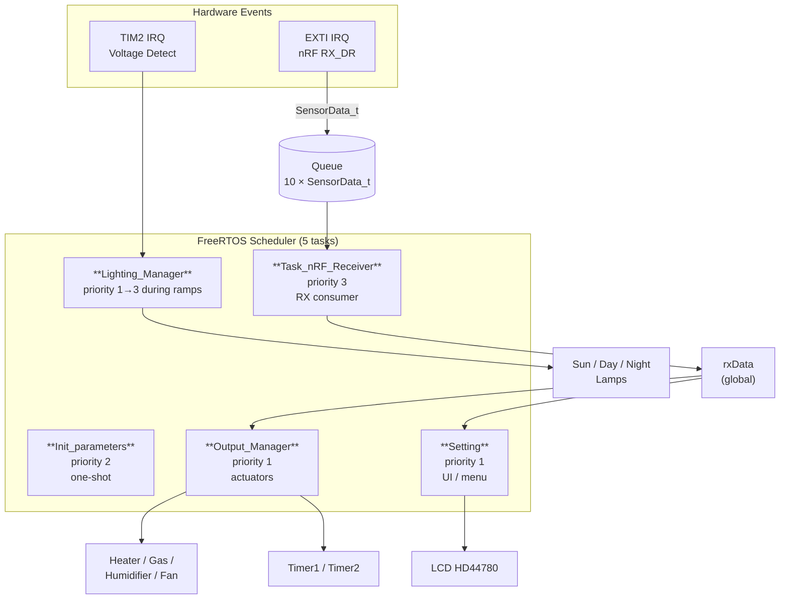
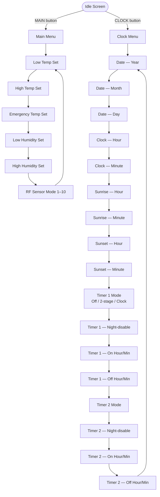

# Z35 Main Board — Poultry & Greenhouse Environmental Controller

[](https://www.st.com/en/microcontrollers-microprocessors/stm32g431rb.html)
[](https://www.freertos.org/)
[](LICENSE)
[](https://github.com/m-elec76/Z35_sensor_board.git)
[](https://github.com/mzurmand/Z35_main_board.git)
[](https://github.com/mzurmand/Z35_sensor_board.git)

The **Main Board** of the Z35 platform — receives wireless sensor data
from a remote node, drives every environmental actuator, and hosts the
entire user interface.

Designed for **ornamental bird breeding halls**, **poultry houses**,
**greenhouses** and **mushroom farms**.

---

## 📑 Table of Contents

1. [System Overview](#-system-overview)
2. [Key Features](#-key-features)
3. [System Architecture](#-system-architecture)
4. [Hardware Pinout](#-hardware-pinout)
5. [Wireless Protocol — nRF24L01+](#-wireless-protocol--nrf24l01)
6. [FreeRTOS Task Model](#-freertos-task-model)
7. [User Interface & Menu Tree](#-user-interface--menu-tree)
8. [Project Status — What's Done](#-project-status--whats-done)
9. [Roadmap — What's Next](#-roadmap--whats-next)
10. [Build & Flash](#-build--flash)
11. [License](#-license)

---

## 🔭 System Overview

The Z35 platform is a dual-board system communicating over a 2.4 GHz radio
link:

| Board          | MCU                | Role                                                     |
|----------------|--------------------|----------------------------------------------------------|
| **Main**       | STM32G431RBT6      | Receives sensor data, drives all outputs, hosts the UI   |
| **Sensor**     | STM32G030C8T6      | Acquires SHT40 / MQ-135 / LDR / PIR data and transmits   |

**This repository holds the Main Board firmware.** Using a separate sensor
board keeps the noisy mains-side actuators (relays, triacs) away from the
analog front-end, dramatically improving measurement accuracy.

### Target applications

- 🐦 Ornamental bird breeding halls
- 🐔 Poultry houses
- 🌱 Greenhouses
- 🍄 Mushroom cultivation rooms

---

## ✨ Key Features

| Feature                          | Details                                                        |
|----------------------------------|----------------------------------------------------------------|
| Wireless link                    | nRF24L01+ @ 2.4 GHz, 250 kbps, 10 selectable profiles          |
| Display                          | HD44780 character LCD, 2 × 16, 4-bit parallel                  |
| Real-time clock                  | Internal RTC + external 32.768 kHz crystal + backup battery    |
| User input                       | 4 push buttons (UP / DOWN / CLOCK / MAIN)                      |
| Main oscillator                  | External 32 MHz crystal                                        |
| Voice output (planned)           | PAM8403 amplifier + W25Q64 SPI flash + PWM audio               |
| Telemetry (planned)              | SIM800C GSM module for SMS + internet                          |
| Data logging (planned)           | SD card via SPI                                                |
| Artificial sunrise / sunset      | Creating gradual changes using a 220V dimmer for incandescent lamps and a PWM for 12V LEDs.          |

---

## 🏗 System Architecture



---

## 🔌 Hardware Pinout

### Actuator Outputs

| Signal           | Port / Pin        | Description                              |
|------------------|-------------------|------------------------------------------|
| `SUN_LAMP`       | GPIOA, PIN 11     | Artificial sunrise / sunset GPIO pulse   |
| `SUN_LAMP_12V`   | GPIOB, PIN 9      | Artificial sunrise / sunset PWM pulse    |
| `LAMP_DAY`       | GPIOA, PIN 9      | Day lamp (220 V)                         |
| `LAMP_NIGHT`     | GPIOA, PIN 10     | Night lamp (220 V)                       |
| `HEATER`         | GPIOA, PIN 8      | Main heater (220 V)                      |
| `GAS_HEATER`     | GPIOB, PIN 8      | Gas heater solenoid valve (12 V)         |
| `EMERGENCY_FAN`  | GPIOC, PIN 8      | Emergency cooler / fan (220 V)           |
| `HUMIDIFIER`     | GPIOC, PIN 6      | Humidifier (220 V)                       |
| `TIMER1_OUT`     | GPIOC, PIN 7      | Timer channel 1 (two-stage / clock)      |
| `TIMER2_OUT`     | GPIOC, PIN 9      | Timer channel 2 (two-stage / clock)      |

### Push Buttons

```c
#define BUTTON_UP       GPIOB, GPIO_PIN_4   /* Navigate up     / value + */
#define BUTTON_DOWN     GPIOD, GPIO_PIN_2   /* Navigate down   / value − */
#define BUTTON_CLOCK    GPIOB, GPIO_PIN_5   /* Enter clock menu / next   */
#define BUTTON_MAIN     GPIOB, GPIO_PIN_3   /* Enter main menu / back    */
```

### Peripherals

| Peripheral       | Interface            | Notes                                  |
|------------------|----------------------|----------------------------------------|
| nRF24L01+        | **SPI2** + EXTI      | RX_DR IRQ on falling edge              |
| LCD HD44780      | 4-bit parallel       | RS / RW / EN + D4–D7                   |
| RTC              | LSE 32.768 kHz       | Backup via VBAT pin                    |
| Main clock       | HSE 32 MHz crystal   |             |
| Voice (planned)  | SPI (W25Q64) + PWM   | Audio → PAM8403 → speaker              |
| GSM (planned)    | USART (SIM800C)      | AT command interface                   |

---

## 📡 Wireless Protocol — nRF24L01+

The link uses **250 kbps**, **2-byte CRC**, **5-byte addresses** and
**auto-retransmit** (1000 µs, 5 retries). Ten profiles are available; the
sensor board and main board **must be set to the same mode** for any
communication to succeed.

### Mode Table

| Mode | Pipe Address (Hex)  | RF Channel | `system_id` |
|:----:|---------------------|:----------:|:-----------:|
| 1    | `A1 B2 C3 D4 E5`    | 76         | `0x6F`      |
| 2    | `67 89 AB CD EF`    | 93         | `0x10`      |
| 3    | `12 34 56 78 9A`    | 27         | `0xBC`      |
| 4    | `0F 1E 2D 3C 4B`    | 35         | `0x59`      |
| 5    | `5A 6B 7C 8D 9E`    | 36         | `0x0C`      |
| 6    | `11 22 33 44 55`    | 40         | `0xDE`      |
| 7    | `AA BB CC DD EE`    | 67         | `0x13`      |
| 8    | `01 23 45 67 89`    | 26         | `0xFA`      |
| 9    | `F0 E1 D2 C3 B4`    | 65         | `0x08`      |
| 10   | `9E 8D 7C 6B 5A`    | 2          | `0x37`      |

### Wireless Payload (10 bytes, packed)

```c
typedef struct __attribute__((packed)) {
    uint8_t  system_id;       /* Network ID — must match on both ends */
    uint8_t  sensor_num;      /* Sensor node number (for multi-node)  */
    uint16_t Temperature;     /* Temperature × 10   [°C]              */
    uint16_t humidity;        /* Relative humidity × 10   [%]         */
    uint16_t gas;             /* Raw ADC value from MQ-135            */
    uint8_t  burglar_alarm;   /* PIR flag: 0 = idle, 1 = alarm        */
    uint16_t ldr;             /* Raw ADC value from LDR               */
} SensorData_t;
```

### Software Filtering

1. The receiver reads the incoming payload in the **EXTI IRQ handler**.
2. It checks `rx.system_id == system_id`. **If mismatched → `nRF24_FlushRX()`** and drop.
3. Only valid payloads are pushed into the FreeRTOS queue.

This gives **two layers of filtering**: hardware address match (pipe 1) plus a
software `system_id` check — reducing cross-talk when multiple Z35 units share
the same hall.

---

## 🧵 FreeRTOS Task Model



| Task                 | Priority | Period         | Responsibility                                          |
|----------------------|:--------:|----------------|---------------------------------------------------------|
| `Init_parameters`    | 2        | One-shot       | nRF24 + LCD init, then `vTaskDelete(NULL)`              |
| `Task_nRF_Receiver`  | 3        | 50 ms loop     | Queue consumption, lux / ppm conversion                 |
| `Lighting_Manager`   | 1 → 3    | 1 ms loop      | Sunrise / sunset FSM (dynamic priority during ramps)    |
| `Setting`            | 1        | 50 ms          | Menu state machine, LCD rendering, RTC, button handling |
| `Output_Manager`     | 1        | 50 ms loop     | Hysteresis control of all actuators, timer logic        |

**Concurrency notes**

- The nRF payload is copied into the queue from the IRQ handler; the task only
  reads from the queue → no data races.
- `rxData` is written only by `Task_nRF_Receiver` and read by `Output_Manager`
  and `Setting` — no lock is required, single-writer pattern.
- `Lighting_Manager` dynamically raises its own priority during ramps to keep
  the ARR sweep tight.

---

## 🎛 User Interface & Menu Tree

### Idle Screen

Two screens can be cycled with the UP / DOWN buttons:

```
┌────────────────┐      ┌────────────────┐
│ 12:34     S1   │      │ 03/08/27  S1   │
│ T:24.5°C H:55% │      │ CO2:412  L:105 │
└────────────────┘      └────────────────┘
     Screen 0                Screen 1
```

- **Screen 0** — clock + temperature + humidity
- **Screen 1** — Persian date + estimated CO₂ (ppm) + LDR lux
- Blinking `:` in the clock indicates the RTC is running
- `S1` in the top-right corner = sensor node number
- `NO Sensor` is shown after 10 s of no wireless traffic

### Menu Tree



### Menu Behavior

| Behaviour             | Description                                                          |
|-----------------------|----------------------------------------------------------------------|
| Auto-exit (short)     | 20 × 50 ms = 1 s of inactivity → back to idle (submenus)             |
| Auto-exit (normal)    | 90 × 50 ms = 4.5 s of inactivity → back to idle (main menu)          |
| Value change          | UP/DOWN buttons, debounced 50 ms                                     |
| Menu navigation       | CLOCK = next, MAIN = back                                            |
| Edge detection        | Last-state flags prevent repeats                                     |
| Save on exit          | Edit buffers are copied to runtime variables on returning to idle    |
| LCD refresh           | Full re-init every 2 minutes to prevent glitches                     |

### Timer Modes

| Mode            | Behaviour                                                                 |
|-----------------|---------------------------------------------------------------------------|
| `Off`           | Output forced OFF                                                        |
| `Two-stage`     | Repeating cycle: ON for `on_H:on_M`, then OFF for `off_H:off_M`, forever  |
| `Clock`         | ON at `on_H:on_M`, OFF at `off_H:off_M` once per day                     |
| Night           | If disabled, the timer is forced OFF during the night window             |

### Threshold Logic (Hysteresis)

| Output         | Turn ON when               | Turn OFF when            |
|----------------|----------------------------|--------------------------|
| Heater + Gas   | T ≤ `LowTemp`              | T ≥ `HighTemp`           |
| Humidifier     | H ≤ `LowHumi`              | H ≥ `HighHumi`           |
| Emergency fan  | T ≥ `EmergencyTemp`        | T ≤ `HighTemp`           |

The gap between ON and OFF thresholds prevents relay chatter.

---

## ✅ Project Status — What's Done

| # | Feature                                                        | Status |
|:-:|----------------------------------------------------------------|:------:|
| 1 | Receiving full sensor payload (T, H, gas, LDR, PIR)            | ✅     |
| 2 | Complete actuator control — heaters, humidifier, fan, 2 timers | ✅     |
| 3 | Complete settings menu (21 states, LCD + 4 buttons)            | ✅     |
| 4 | Persian (Jalali) calendar conversion + RTC set                 | ✅     |
| 5 | Artificial sunrise / sunset FSM                                | ✅     |
| 6 | 10 nRF24 profiles with hardware + software filtering           | ✅     |
| 7 | Adaptive task priority during sun ramps                        | ✅     |
| 8 | Hysteresis control on temperature and humidity                 | ✅     |
| 9 | LCD auto-refresh + no-sensor indication                        | ✅     |

---

## 🗺 Roadmap — What's Next

| # | Feature                                  | Notes                                                                          |
|:-:|------------------------------------------|--------------------------------------------------------------------------------|
| 1 | **Persistent settings storage**          | Save thresholds, timers, RTC config to internal flash or external EEPROM       |
| 2 | **Voice guide system**                   | PAM8403 + W25Q64 flash over SPI, PWM audio output — announces menus & alarms   |
| 3 | **12 V LED sunrise / sunset**            | Drive the 12 V LED strip                                                       |
| 4 | **GSM + internet via SIM800C**           | SMS alerts, remote monitoring, AT command interface over USART                 |
| 5 | **OTA firmware update**                  | Remote update over GSM                                                         |
| 6 | **SD-card datalogger**                   | Periodic logging of temperature, humidity, gas and light                       |
| 7 | **Clock calibration**                    | Allow the user to correct RTC drift over time                                  |
| 8 | **Lock clock button during sunrise/sunset** | Prevent menu entry while the sun FSM is running to avoid glitches           |
| 9 | **Watchdog timer (IWDG)**                | Automatic recovery from lock-ups                                               |
| 10 | **Spring simulator**                    | User defines a time window: daily ±N minutes of daylight + temperature offset  |
| 11 | **Multi-sensor averaging**              | Support 2+ sensor nodes; average or per-node display                           |

---

## 🛠 Build & Flash

### Requirements

- STM32CubeIDE 1.18 or newer
- ST-Link V3 programmer
- Firmware package: `STM32Cube FW_G4 V1.5.1`

### ⚠️ Important — RTC Reset on CubeMX Regeneration

Whenever you regenerate the project from CubeMX and reopen it in CubeIDE,
CubeMX rewrites **default time and date values** into `Core/Src/rtc.c` inside
the `/* Initialize RTC and set the Time and Date */` block. **This resets the
RTC and breaks the scheduling logic.**

👉 After every CubeMX regeneration, comment out the default time/date
initialization in `rtc.c`:

```c
/* USER CODE BEGIN Check_RTC_BKUP */
// Do NOT uncomment unless you want to reset the RTC
// sTime.Hours   = 0x0;
// sTime.Minutes = 0x0;
// sTime.Seconds = 0x0;
// sDate.WeekDay = RTC_WEEKDAY_MONDAY;
// sDate.Month   = RTC_MONTH_JANUARY;
// sDate.Date    = 0x1;
// sDate.Year    = 0x0;
// if (HAL_RTC_SetTime(&hrtc, &sTime, RTC_FORMAT_BCD) != HAL_OK) { Error_Handler(); }
// if (HAL_RTC_SetDate(&hrtc, &sDate, RTC_FORMAT_BCD) != HAL_OK) { Error_Handler(); }
/* USER CODE END Check_RTC_BKUP */
```

---

## 📜 License

Copyright 2026 Mohammadali Abbasi

Licensed under the Apache License, Version 2.0 (the "License");
you may not use this file except in compliance with the License.
You may obtain a copy of the License at

    http://www.apache.org/licenses/LICENSE-2.0

Unless required by applicable law or agreed to in writing, software
distributed under the License is distributed on an "AS IS" BASIS,
WITHOUT WARRANTIES OR CONDITIONS OF ANY KIND, either express or implied.
See the License for the specific language governing permissions and
limitations under the License.

---

## 🙏 Credits

- **Firmware Author:** Mohammadali Abbasi <m.elec76a@gmail.com> — designed and implemented the complete firmware (FreeRTOS architecture, all application tasks, wireless protocol, UI state machine, actuator control)
- **Hardware Designer:** Mohammadreza Zourmand <mzselec@gmail.com> — custom 2-layer PCB, mains-isolated
- **HAL driver:** STMicroelectronics

---

> **Z35 Main Board** — the brain of the environmental controller.